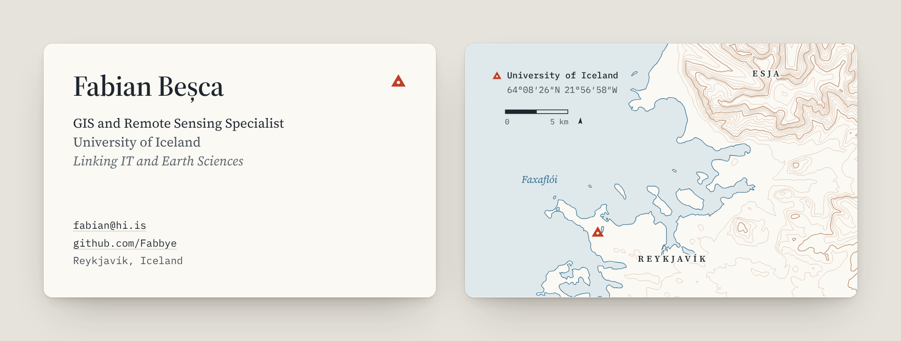

# fabbye.github.io

My business card on the web: who I am, what I work on and how to reach me, on one page.

**[fabbye.github.io](https://fabbye.github.io)**

<picture>
  <source media="(prefers-color-scheme: dark)" srcset="assets/preview-dark.png">
  
</picture>

## What is on it

* **The front of the card:** name, role, email and GitHub.
* **The back of the card:** a small topographic map of Reykjavík and Esja, with the University of Iceland marked.
* **Save contact:** a vCard ([fabian-besca.vcf](fabian-besca.vcf)) that puts my details straight into a phone's contacts.
* **A short summary** of what I work on now, earlier work, the tools I use and my education.

The page is plain HTML and CSS: no framework, no build step, no JavaScript, no trackers and no requests to other sites. The fonts are served from this repository. The page follows the light or dark setting of the device and works on any screen size.

## The map

The back of the card is drawn from real elevation data by [map/make_map.py](map/make_map.py). The script:

1. Downloads the two Copernicus DEM GLO-30 tiles that cover Reykjavík and Esja.
2. Projects them onto one 25 m grid in ISN93 / Lambert 1993 (EPSG:3057).
3. Smooths the surface slightly and draws contours every 50 m, with every 250 m drawn heavier.
4. Takes the coastline from the land and sea mask and simplifies all the lines.
5. Writes the map into [index.html](index.html), with the marker on the University of Iceland Main Building, a scale bar and a north arrow turned by the grid convergence at that point (2.7°).

To draw it again, for example for a different area or contour interval:

```
pip install numpy scipy rasterio contourpy shapely pyproj
python map/make_map.py
```

## Changing the content

* Text and links: [index.html](index.html)
* Colours, fonts and layout: [style.css](style.css)
* Contact card: [fabian-besca.vcf](fabian-besca.vcf)

GitHub Pages publishes every push to `main`.

## Credits

* **Elevation data:** Copernicus DEM GLO-30, © DLR e.V. 2010-2014 and © Airbus Defence and Space GmbH 2014-2018, provided under COPERNICUS by the European Union and ESA; all rights reserved.
* **Fonts:** [Source Serif 4](https://github.com/adobe-fonts/source-serif) and [IBM Plex Mono](https://github.com/IBM/plex), both under the SIL Open Font License ([fonts](fonts)). Source Serif 4 is cut down to the weights and characters the page uses.
